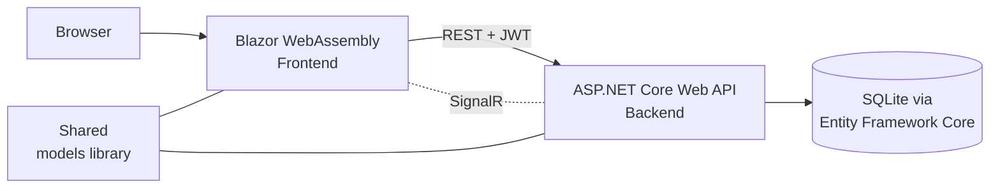

# CO₂ Emissions Tracker

A web application for recording CO₂ emissions and following them over time — with statistics by type, source and month, CSV reports and tips for reducing emissions.

Built as a 3-person university project at VIA University College (December 2024). I led the project and worked across the backend, frontend, database and documentation (see [Team](#team)).

## What it does

- **Record emissions** with date, type, source and amount
- **Dashboard** with totals, monthly and daily averages, and breakdowns by type and source
- **CSV reports** of a user's emissions for download
- **Eco tips** on the dashboard for reducing emissions
- **Accounts and roles** – registration, login with JWT, admin area for user management
- **Live notifications** via SignalR

## Architecture



| Part | Technology |
|---|---|
| Frontend | Blazor WebAssembly (.NET 9), Blazored.LocalStorage |
| Backend | ASP.NET Core Web API (.NET 9), 7 controllers / 23 endpoints, Swagger |
| Data | Entity Framework Core, SQLite, code-first migrations |
| Security | JWT bearer authentication, BCrypt password hashing, role-based authorization |
| Reports | CsvHelper |
| Real time | SignalR |

## Run it locally

Requires the [.NET 9 SDK](https://dotnet.microsoft.com/download).

```bash
git clone https://github.com/aleks-al-aleksandrov/co2-emissions-tracker.git
cd co2-emissions-tracker

# The JWT signing key is not stored in the repository - set your own (32+ characters):
export JwtSettings__SecretKey="replace-with-a-long-random-string-of-32-chars"   # Windows: set JwtSettings__SecretKey=...

dotnet run --project Backend     # API + Swagger on http://localhost:5001/swagger
dotnet run --project Frontend    # app on http://localhost:5000  (second terminal)
```

The SQLite database is created and migrated automatically on first start, and the user roles are seeded. Register a new account in the app to get started.

## Project structure

```
Backend/      ASP.NET Core API: controllers, services, EF Core context, migrations
Frontend/     Blazor WebAssembly app: pages, components, services
Shared/       Models shared between frontend and backend
docs/dev-log/ Development log written during the project (requirements → design → demo)
```

## Team

| | Main contributions |
|---|---|
| **Aleks Aleksandrov** (lead) | Project goals and requirements, core API design, statistics service, JWT login/registration, database schema and migrations, dashboard layout, most of the documentation |
| **Miguel Espinosa González** | Statistics and report endpoints, CSV report generation, dashboard charts, API documentation |
| **Jorge Catalá Manglano** | Frontend design and UX, input validation, testing of API endpoints and file downloads |

## What I would improve

- Calculate emissions from activity data (e.g. km driven, kWh used) with standard emission factors, instead of entering CO₂ amounts directly
- Add automated tests for the statistics and report services
- Replace the open CORS policy with an explicit list of allowed origins for production

---

The two reports in `Frontend/wwwroot/PDF` are publications of the European Commission's Joint Research Centre (EDGAR), © European Union, reused under the Commission's reuse policy.
